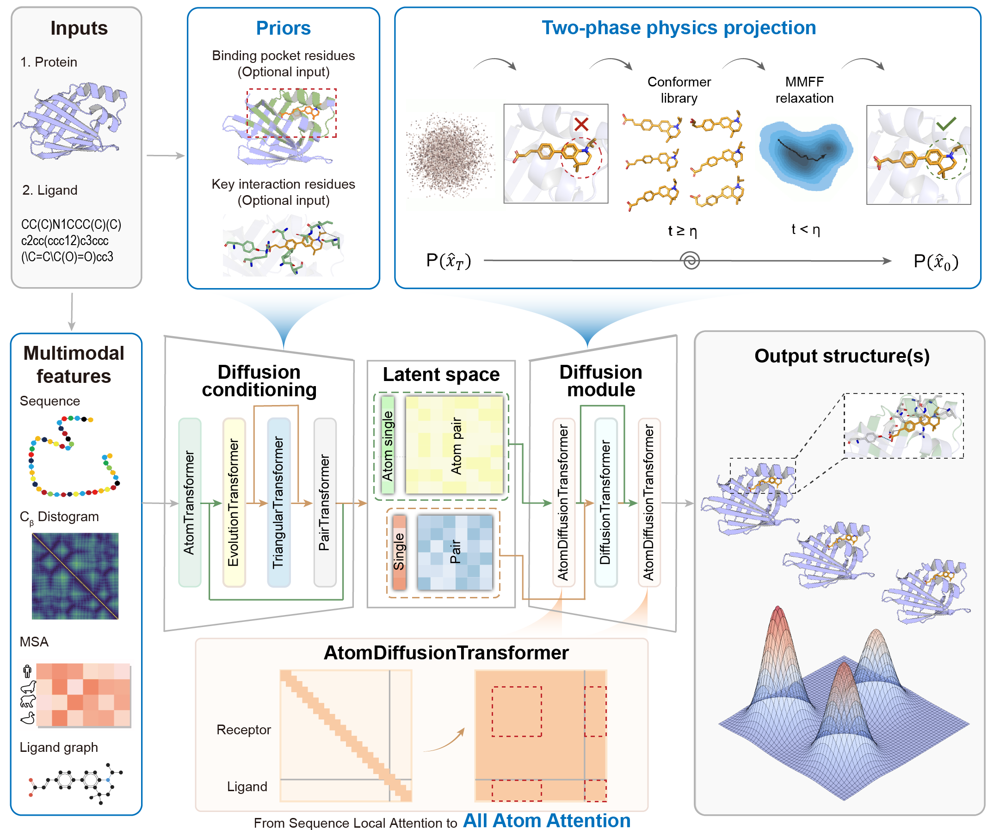
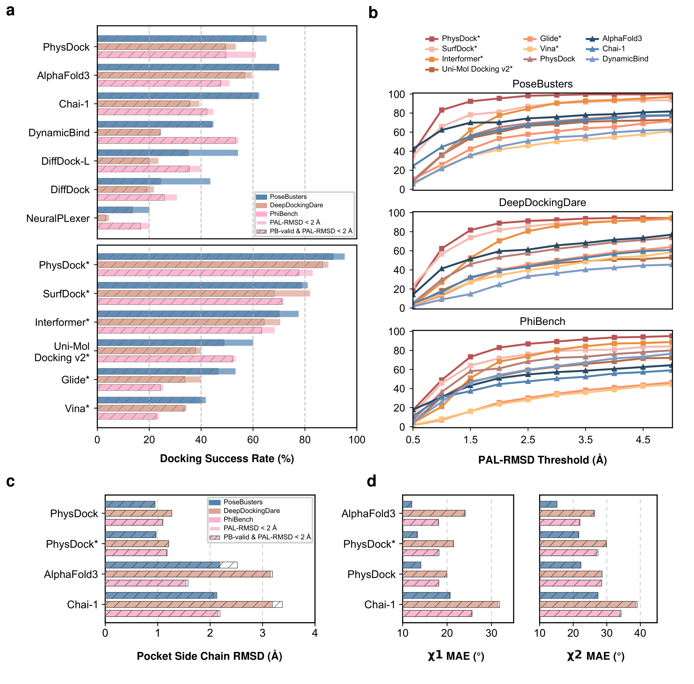
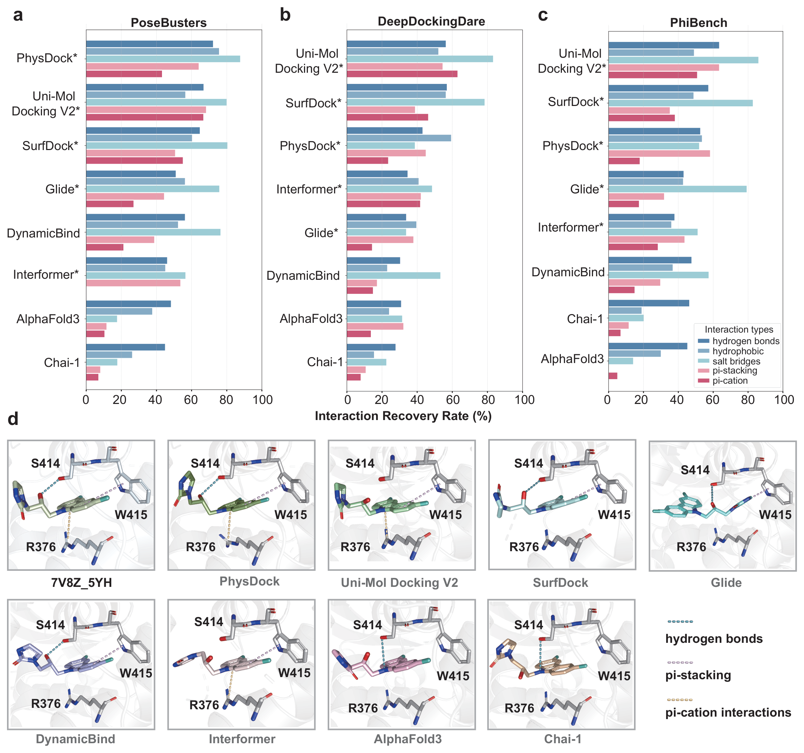
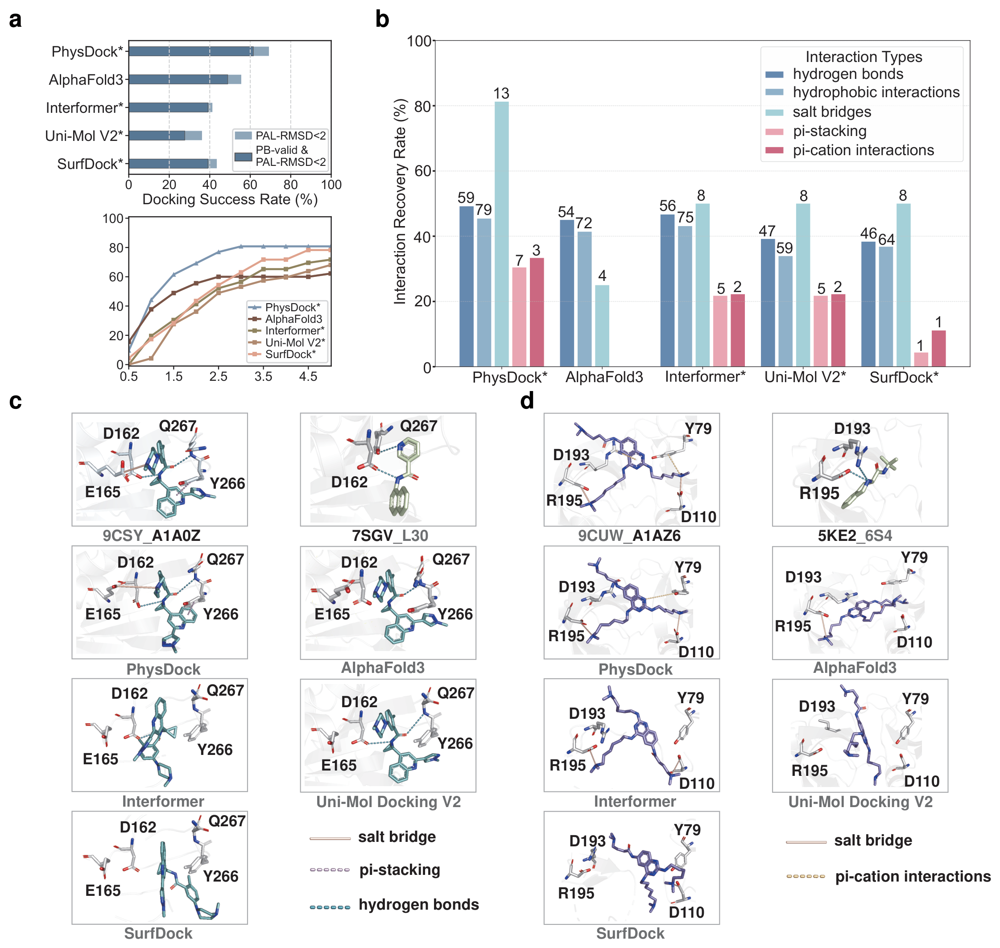
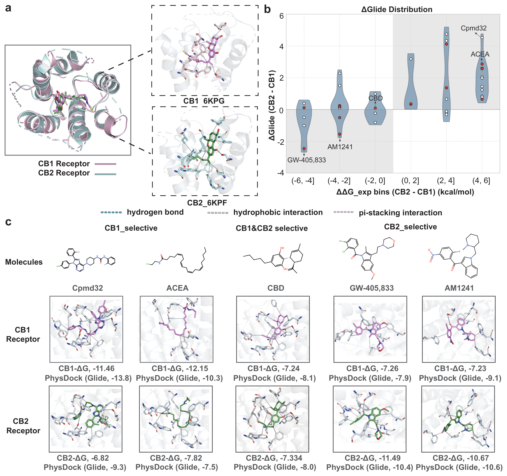
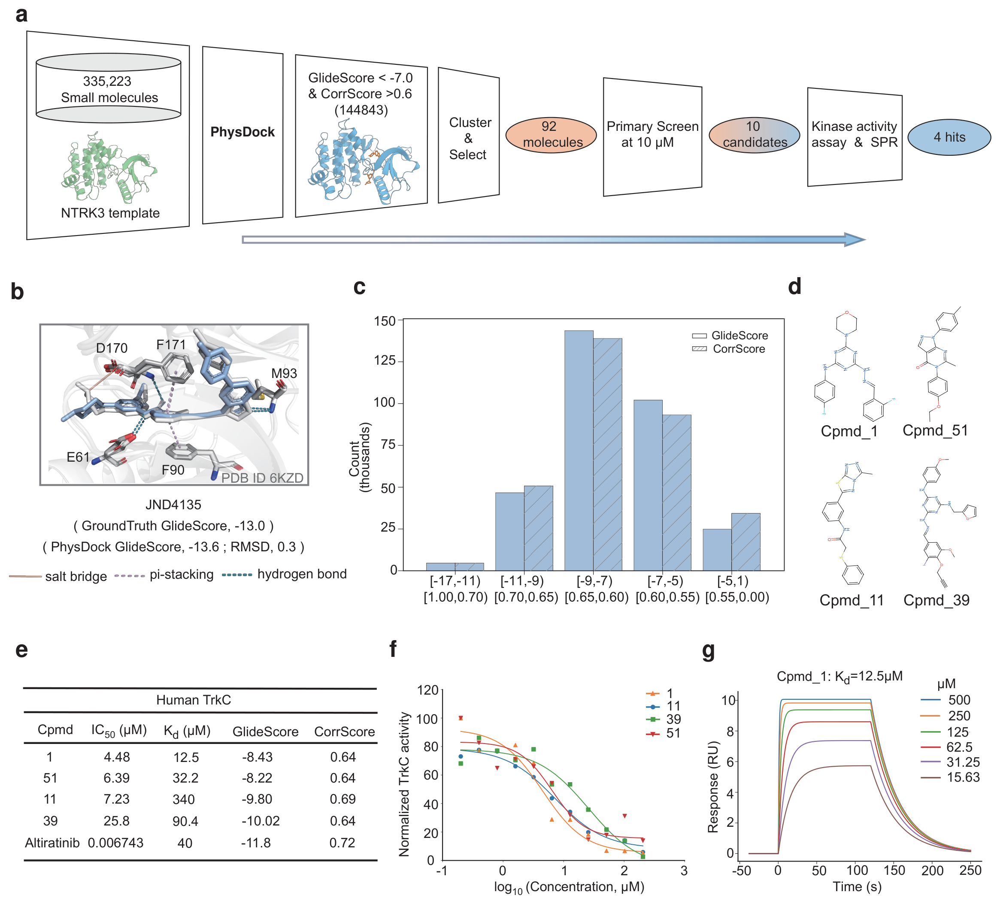
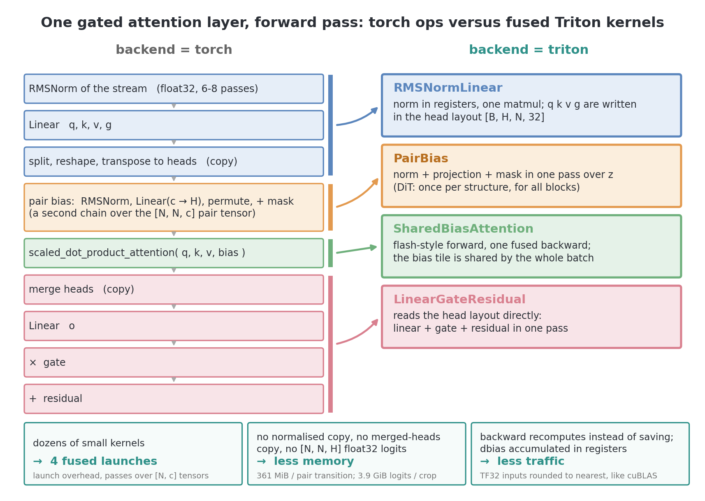
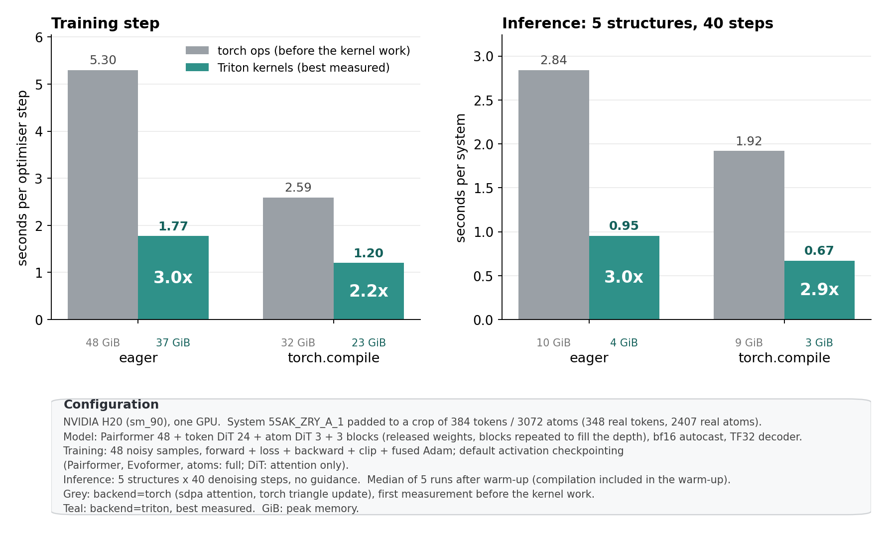
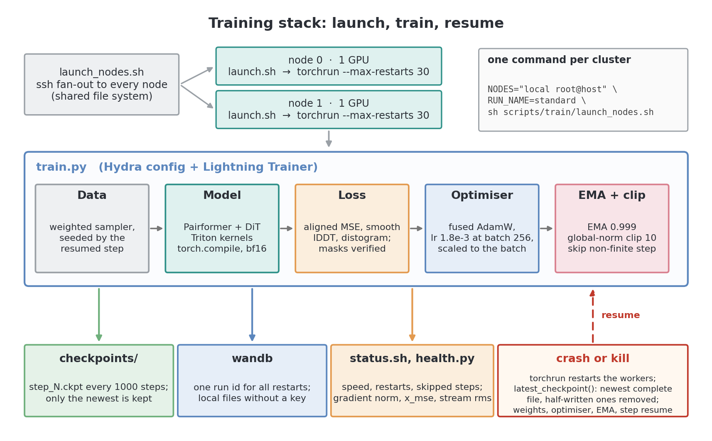

<div align="center">

# PhysDock

### A Physics-Guided All-Atom Diffusion Model for Protein–Ligand Complex Prediction

[](https://doi.org/10.1101/2025.04.28.650887)
[](#citation)
[](environment.yaml)
[](environment.yaml)
[](environment.yaml)
[](#triton-kernels-up-to-3x-faster-on-an-nvidia-h20)
[](License)

[**What's new**](#whats-new) ·
[**Results**](#results) ·
[**Triton kernels**](#triton-kernels-up-to-3x-faster-on-an-nvidia-h20) ·
[**Installation**](#installation) ·
[**Inference**](#inference) ·
[**Training**](#training) ·
[**Data**](#available-data) ·
[**Citation**](#citation)

<br>



</div>

<br>

**PhysDock** is a non-equivariant, **all-atom denoising diffusion model** for predicting flexible protein–ligand complex structures. Instead of treating the pocket as a rigid body, it diffuses *every* atom, so ligand flexibility and protein conformational adjustment are modelled together, and it brings **physics** into the loop twice: as priors that condition the diffusion, and as a two-phase guidance during denoising that keeps ligands chemically sensible.

* **State of the art on redocking.** PhysDock reaches the highest success rates on PoseBusters, DeepDockingDare and our PhiBench, and outperforms leading models by 15% on the harder cross-docking task.
* **Physics-guided sampling.** Reference-conformer alignment at high noise, MMFF relaxation at low noise, and a chirality-checked multi-round physical correction.
* **From the benchmark to the bench.** It resolves cannabinoid-receptor selectivity across diverse molecules, and tells most drug candidates from weak binders in a TrkC-kinase virtual screen.
* **Fast and complete.** Fused Triton kernels (up to 3x faster training and inference on an NVIDIA H20), a Lightning training stack with one-command multi-node launch and automatic resume, and Hydra configs for every entry point.

> PhysDock currently supports **multiple protein chains** and **one small-molecule ligand** per system.

---

## What's new

Changes since the previous release (tag `Pub`, the code that accompanies the manuscript). **The released `params.pt` still loads**: a single converter, `PhysDock/utils/import_old_weights.py`, maps the old parameter layout to the current one.

| | |
|---|---|
| **Triton kernels** | Eight fused kernels cover the attentions, triangle updates, pair biases, feed-forwards and the outer product mean, with a one-line switch (`model.backend=triton`). Up to **3x faster training and inference** on an H20 with less memory. [Details](#triton-kernels-up-to-3x-faster-on-an-nvidia-h20) |
| **A training stack** | `Pub` shipped a Uni-Core reference template. Now: a PyTorch Lightning pipeline with `torch.compile` region by region, per-stack activation checkpointing, `torchrun` multi-node launch that **restarts after a crash and resumes from the newest complete checkpoint**, a rolling single checkpoint, one wandb run across restarts, and gradient and stream diagnostics. [Details](#training) |
| **AlphaFold 3 optimiser recipe** | Fused AdamW with AlphaFold 3's betas and epsilon, the learning rate scaled from AlphaFold 3's 1.8e-3 at batch 256 to the batch of the run, 1000-step warm-up, step decay, EMA and global-norm clipping. |
| **Linear (flow-matching) diffusion** | Besides the EDM variance-exploding diffusion, `configs/model/medium_linear.yaml` trains with the linear interpolation path and velocity target of PhysDock2 (see [Citation](#citation)), which is friendlier to few-step sampling. |
| **Correct masks, verified** | The padding of every attention and of every loss term is covered by a whole-model invariance test: the real part of the output, all loss terms and all gradients must not change when the padding is cut away or filled with garbage. The loss was fixed (padding tokens in the distogram, atom self-pairs in smooth lDDT, a clamp that silenced large gradients), as were four gradient pathologies found while training from scratch. |
| **Cleaner model code** | Residual-form layers, merged Q/K/V/G projections, kernel-level modules with identical torch and Triton paths, a precompute-once layer for all DiT pair biases and AdaLN modulations, one loss module instead of three, and no dead code. |
| **Organised entry points** | `scripts/` and Hydra `configs/` for system preparation, MSA search, redocking, screening and training (every value overridable as `key=value`); one resumable, checksum-verifying downloader instead of per-dataset shell scripts. |
| **Optional distance-decay attention** | A flat-bottom, noise-aware distance penalty on the atom attentions (`model.decoder.atom_decay`), for physics-flavoured locality; off by default. |
| **Batched inference** | `model.skip_padding=true` skips the padding of padded crops (about 12% faster on one GPU at 80% occupancy), with no cost when off. |
| **One environment** | A single `environment.yaml` for CUDA 12.4 (Python 3.11, PyTorch 2.6, Triton 3.2). The OpenMM side-chain relaxation stack was removed, which also makes the environment about 30% smaller. |
| **Tests** | `pytest tests` runs 32 tests: padding and mask invariance of the whole model for both backends, gradients against float64 references, resume logic, distance decay. |

---

## Method at a glance

PhysDock encodes the system with a conditioning module (atom transformer, MSA/Evoformer, template and Pairformer stacks over tokens), then denoises all atom coordinates with a multi-scale diffusion module (atom DiT → token DiT → atom DiT). At sampling time the denoised ligand is **projected** onto physically plausible conformers:

| noise level | projection |
|---|---|
| high (`t ≥ η`) | align the denoised ligand to the closest reference conformer from an RDKit conformer library |
| low (`t < η`) | a few MMFF94 relaxation steps per denoising step |

`η` adapts from round to round in physical-correction mode (`sampling.eta`). Final samples are clustered with K-means for ranking.

**Diffusion variants.** `diffusion.type: edm_ve` is the EDM variance-exploding process of the released model. `diffusion.type: linear` is the flow-matching form from PhysDock2, `z_t = (1 − t)·x + t·ε` with the velocity `ε − x` as the network target and an Euler step as the update rule, which discretises well with few solver steps.

---

## Results

PhysDock achieves state-of-the-art success rates on three redocking benchmarks, with and without prior pocket information (Fig. 2 of the manuscript):

<div align="center">

</div>

<sub>**a** Docking success rate on PoseBusters (N = 428), DeepDockingDare (N = 356) and PhiBench (N = 206); asterisks mark predictions with prior pocket information. **b** Success rate versus the PAL-RMSD threshold. **c**, **d** Side-chain RMSD and χ1/χ2 error of the binding-pocket residues of successfully docked cases.</sub>

<details>
<summary><b>More results: interactions, cross-docking, receptor selectivity, virtual screening</b></summary>

<br>

<div align="center">



<sub><b>Interaction recovery.</b> Recovery rate of non-covalent interactions and predicted binding modes in the redocking benchmarks.</sub>

<br><br>



<sub><b>Cross-docking.</b> Success rates under PAL-RMSD &lt; 2 Å and PB-valid &amp; PAL-RMSD &lt; 2 Å, interaction recovery, and two representative cases.</sub>

<br><br>



<sub><b>Cannabinoid-receptor selectivity.</b> CB1 (PDB 6KPG) versus CB2 (PDB 6KPF): the GlideScore difference of PhysDock poses against the experimental binding free-energy difference.</sub>

<br><br>



<sub><b>Virtual screening for TrkC (NTRK3) inhibitors.</b> About 335k SPECS molecules were docked, filtered (GlideScore &lt; −7.0, CorrScore &gt; 0.6), clustered and tested, giving four confirmed hits.</sub>

</div>

</details>

The benchmark data, features and predictions are available from Zenodo ([Available data](#available-data)).

---

## Triton kernels: up to 3x faster on an NVIDIA H20

The compute of PhysDock is dominated by operators that torch runs as many small passes over large tensors: normalisation, thin matmuls, gating, residual adds, and attention with a pair bias. This release replaces them with **eight fused Triton kernels** (`PhysDock/models/kernels/`), wrapped as drop-in modules (`PhysDock/models/primitives/`) that have identical parameters and identical function in both backends:

```shell
python scripts/train/train.py model.backend=triton compile=true     # training
python scripts/infer/infer.py ... model.backend=triton              # inference
```

<div align="center">

</div>

### Speed on one H20

<div align="center">

</div>

| | torch ops | Triton (best measured) | speed-up |
|---|---|---|---|
| training step, eager | 5.30 s, 48 GiB | **1.77 s**, 37 GiB | 3.0x |
| training step, `torch.compile` | 2.59 s, 32 GiB | **1.20 s**, 23 GiB | 2.2x |
| inference (5 structures, 40 steps), eager | 2.84 s, 9.7 GiB | **0.95 s**, 3.6 GiB | 3.0x |
| inference (5 structures, 40 steps), `torch.compile` | 1.92 s, 8.7 GiB | **0.67 s**, 3.2 GiB | 2.9x |

**Measured configuration.** NVIDIA H20 (sm_90), one GPU, system 5SAK_ZRY_A_1 padded to a crop of 384 tokens / 3072 atoms (348 real tokens, 2407 real atoms). Pairformer 48 + token DiT 24 + atom DiT 3 + 3 blocks (the released weights with the blocks repeated to fill the depth), bf16 autocast, TF32 decoder. Training: 48 noisy samples, forward + loss + backward + gradient clipping + fused Adam, with the default activation checkpointing (Pairformer, Evoformer and atom stacks fully recomputed, DiT attention only). Inference: five structures, 40 denoising steps, no guidance. Median of five runs after warm-up (compilation included in the warm-up). The torch column is the first measurement with `model.backend=torch` (sdpa attention, torch triangle update) before the kernel work; the Triton column is the best result measured during development.

### What is fused

| module (`primitives`) | one kernel replaces | what it saves |
|---|---|---|
| `SharedBiasAttention` | flash-style attention with a pair bias **shared by the batch**; the fused backward keeps `dbias` in registers | 1.7–2x faster than sdpa in forward + backward (bf16), 2–5x in the TF32 forward; used by every DiT, triangle attention, single attention and MSA-row attention |
| `TriangleMultiplication` | norm, merged projection, gating, per-channel `N×N` products and output projection in six kernels | 2.5–4x faster than torch eager, ahead of `torch.compile` in forward + backward |
| `RMSNormPairBias` / `LayerNormPairBias` | norm, projection to heads and mask in a single pass over the pair tensor; the DiT biases of all blocks are computed once per structure | the atom-pair bias of 2048 atoms goes from 6.2 ms to 0.96 ms, and a 3.9 GiB logits tensor per crop of 3072 atoms is never written |
| `RMSNormLinear` | RMSNorm and the merged Q/K/V/G projection, written directly in the head layout | no normalised copy of the input is kept or written |
| `LinearGateResidual` | output projection, gate and residual add, reading the attention output in its head layout | no merged-heads copy, no separate elementwise passes |
| `OuterProductMean` | projection, outer product, output linear, RMSNorm and residual | the `N×N×32×32` outer product (300 MiB at 384 tokens) only ever exists as a register tile |
| `RMSNormSwiGLUFFN` | norm, both SwiGLU stages and the residual; the backward recomputes the hidden units | 1.2x faster forward, and 361 MiB less per pair transition (17 GiB over 48 blocks) |
| `SwiGLUFFN` | the feed-forward on the narrow atom-pair features | the three `[…, 128]` hidden tensors (7.2 GiB at 3072 atoms) are never kept |

### Design principles

* **Fuse only what pays.** A kernel is used only where it beats the cuBLAS/torch path for the shapes of the model; every module has a guard (`can_fuse`: shape, dtype, matmul precision, grad mode) and otherwise runs its torch path. The AdaLN-SwiGLU transition of the DiT is deliberately *not* fused: the kernel was 1.1x faster forward but 2x slower backward.
* **Precision is never below torch.** TF32 inputs are rounded to nearest the way cuBLAS does it (the Triton default truncates, which makes gradients about 6x less accurate), bf16 under autocast, float32 accumulation; norms, softmax and gates run in float32, and the diffusion decoder stays in TF32 because its coordinates are sensitive to rounding.
* **Fixed launch configurations.** No autotuning pass (which costs minutes of compilation per shape): the block sizes, warps and stages were swept once on an H20 and are fixed.
* **Recompute instead of save.** Backward kernels recompute hidden activations from the inputs, which is where the memory goes down.
* **`torch.compile`-friendly.** Every kernel sits behind a `torch.library.custom_op` with a fake implementation whose strides match the real one, so compiled regions treat it as an opaque op.
* **Verified.** Unit tests compare values and every gradient against float64 references, and a whole-model test checks that the padding does not influence outputs, losses or gradients for either backend.

The Triton kernels were tuned and validated on an **NVIDIA H20 (sm_90)**; the torch backend (`model.backend=torch`) runs on any CUDA GPU.

---

## Installation

PhysDock searches MSAs for the receptor sequence, which needs the corresponding tools and five sequence databases (only for new proteins: the demo and benchmark systems ship their MSA features).

```shell
# Bio tools for the MSA search
apt install hhsuite hmmer

# Sequence databases (UniRef90, MGnify, UniProt, Uniclust30, BFD) -> data/homo_data
# ~465 GB download, ~2.3 TB after extraction; parallel, resumable, checksum-verified
python scripts/download/download_homo_data.py                       # all five
python scripts/download/download_homo_data.py --only uniref90 bfd   # or a subset
```

One conda environment for everything (CUDA 12.4, Python 3.11, PyTorch 2.6, Triton 3.2):

```shell
conda env create -f environment.yaml
conda activate PhysDock
```

Model parameters (`--link` makes `data/params/params.pt`, which the inference scripts load, a symlink to the download):

```shell
# latest EMA parameters (params.pt) and the ones used in the paper (params_2418.pt)
python scripts/download/download_params.py --link
```

<details>
<summary>About the downloader</summary>

All `scripts/download/download_*.py` share one engine (`scripts/download/downloader.py`): every file is fetched with up to `--workers` (default 96) parallel connections of small byte ranges, progress is checkpointed so that re-running an interrupted command resumes it, every file is verified against the checksum published by its host (md5, or crc32c / gzip-CRC where that is all the host provides), and archives are merged and extracted as soon as they are verified. Source archives stay under `data/<section>/tmp` unless `--delete-archives` is given. `--dry-run` shows what would be downloaded and `python scripts/download/download_all.py` fetches the parameters, benchmarks and training set at once (`--all` adds the sequence databases). Everything lands in `<repo>/data`; only `data/demo` is tracked by git. `pip install google-crc32c` enables fast crc32c verification of the MGnify database.

</details>

---

## Inference

### Quick start

```shell
sh scripts/infer/infer.sh                # redock one demo system  -> out/5SAK_ZRY
sh scripts/infer/redocking.sh            # all demo systems (ranking=true needs scikit-learn)
```

Every entry point reads its settings from `configs/` ([Hydra](https://hydra.cc)): any yaml value can be overridden as `key=value` (nested keys with dots, also as extra arguments of the demo scripts) and `--cfg job` prints the resolved configuration.

```shell
# one system with explicit inputs, Triton kernels, bf16 encoder
python scripts/infer/infer.py \
  input_pkl=data/demo/redocking/Posebusters_subset/5SAK_ZRY_A_1.pkl.gz \
  msa_features=data/demo/redocking/features/msa_features \
  uniprot_msa_features=data/demo/redocking/features/uniprot_msa_features \
  output_dir=out/5SAK_ZRY model.backend=triton precision=bf16-mixed

python scripts/infer/redocking.py --cfg job      # all options and their defaults
```

### System preparation

A *system* is one or more receptor chains plus a ligand. The input is a receptor **`.pdb`** and a ligand **`.sdf`**; the output is the raw feature file (**`.pkl.gz`**) of the structure together with the MSA features (`msa_feature`, `uniprot_msa_feature`) found by searching the sequence databases. The MD5 of the protein sequence is the query key, so MSA features are reused across systems. The raw features can also carry the key interacting residues computed by **PLIP**, which are given to the model with some probability.

```shell
sh scripts/prepare/prepare_system.sh     # receptor PDB + ligand SDF + ligand CCD id -> system .pkl.gz and FASTA
sh scripts/prepare/homo_search.sh        # MSA search (databases in data/homo_data, or HOMO_DATA=<dir>)
```

### Redocking, virtual screening, full pipeline

```shell
sh scripts/infer/redocking.sh            # redock a folder of systems   (configs/redocking.yaml)
sh scripts/infer/screening.sh            # virtual screening            (configs/screening.yaml)
sh scripts/infer/docking.sh              # prepare -> MSA search -> redocking
```

When screening against a pocket, the ligand position in the system `.pkl.gz` defines the pocket. Blind docking, cross docking and flexible standard-precision docking follow from other parameter choices of the same scripts.

### Physics guidance and physical correction

```shell
# multi-round sampling with chirality checks, reference-conformer templates and MMFF guidance
python scripts/infer/redocking.py ... sampling.physics_correction=true sampling.max_rounds=6 sampling.num_samples_per_round=5
```

`sampling.eta` (the start of the low-noise MMFF regime, default 6.0), `sampling.mmff_iters` and `sampling.num_confs` tune the projection. Used directly through the API, `model.sample_diffusion(..., align_ref_pos=True)` aligns to a reference conformer at high noise; give it `mmff_gamma_0_factor=6.0` as the redocking scripts do, otherwise the alignment dominates almost the whole trajectory.

---

## Training

```shell
sh scripts/train/train.sh                                       # quick test: toy model, 200 steps, wandb offline
python scripts/train/train.py                                   # released model size, 1 GPU
python scripts/train/train.py trainer=ddp                       # all GPUs of the node
python scripts/train/train.py init_from=data/params/params.pt   # fine-tune the released weights
```

The released training set is fetched with `python scripts/download/download_dataset.py` (`data/v1`, about 145 GB).

<div align="center">

</div>

### Multi-node launch with automatic resume

`scripts/train/launch.sh` trains the standard model (Pairformer 24, atom DiTs 3 + 3, token DiT 12; crop 256 / 2048 atoms; bf16 mixed precision; `torch.compile`; Triton kernels; no activation checkpointing) under `torchrun`. Run it on every node:

```shell
# one node, one GPU (or GPUS_PER_NODE=8)
RUN_NAME=standard sh scripts/train/launch.sh

# two nodes, one DDP run: NODE_RANK=0 on the node MASTER_ADDR points to
NNODES=2 NODE_RANK=0 MASTER_ADDR=10.0.0.1 RUN_NAME=standard sh scripts/train/launch.sh
NNODES=2 NODE_RANK=1 MASTER_ADDR=10.0.0.1 RUN_NAME=standard sh scripts/train/launch.sh

# or start it on several machines over ssh (shared file system; one run per node here)
NODES="local root@10.0.0.2:22" RUN_NAME=standard sh scripts/train/launch_nodes.sh
```

Everything lives in `logs/train/$RUN_NAME`. A crash restarts the workers (up to `MAX_RESTARTS`) and the restarted run **resumes from the newest complete checkpoint** (`ckpt_path=auto`: a half-written checkpoint is detected and removed), with the same wandb run and a data sampler seeded from the resumed step. Started again with the same `RUN_NAME`, a run continues where it stopped. `BACKEND=torch` switches off the Triton kernels, `COMPILE=false` the compilation, and any further argument is a Hydra override.

| default (`configs/trainer/default.yaml`) | |
|---|---|
| optimiser | fused **AdamW**, betas (0.9, 0.95), eps 1e-8, weight decay 0 (applied to weight matrices only if set) |
| learning rate | **1.8e-3 at a batch of 256 structures** (AlphaFold 3), scaled to the batch of the run by the square-root rule: `lr = 1.8e-3 · (batch / 256)^½`, so 1.1e-4 for one structure per step |
| schedule | 1000 warm-up steps, a plateau, then ×0.99 every 5000 steps |
| EMA | 0.999, updated every optimiser step; validation and checkpoints for inference use it |
| clipping | global gradient norm 10; a step with a non-finite gradient is skipped and counted (`train/skipped_steps`) |
| checkpoints | every 1000 steps, **only the newest is kept** |

A model trained from scratch conditions on the noise level as `ln(t)/4` (`model.diffusion.noise_conditioning=af3`, set by `launch.sh`); the `legacy` form is only for the released weights.

### Monitoring

Training logs to [wandb](https://wandb.ai) (`wandb login` or `WANDB_API_KEY` once; without a key the run is logged to local files and `sh scripts/train/wandb_sync.sh` uploads it later; `logger=null` turns logging off):

* every step: `train/loss`, each loss term, `train/lr`, and `train/rms_{a,s,z}`, the scale of the encoder streams
* every `trainer.log_every_n_steps`: `train/grad_norm` and the gradient norm of every module (`grad_stats=parameter` adds every parameter)
* every validation: the diffusion loss and, from structures sampled by the model, ligand RMSD, success rate (< 2 Å), ligand MSE, smooth lDDT, ligand bond/angle error and inter-chain clashes

```shell
sh scripts/train/status.sh standard                     # running / step / speed / loss / restarts of every run
python scripts/train/health.py logs/train/standard      # per-block medians and warnings (gradient norm, x_mse, stream scale)
```

### Performance knobs

```shell
python scripts/train/train.py compile=true                          # torch.compile, region by region
python scripts/train/train.py checkpointing.Evoformer=none          # per stack: full | none | a fraction | attention (DiT)
python scripts/train/train.py trainer.precision=bf16-mixed          # bf16 encoder (decoder, distogram and loss stay float32)
python scripts/train/train.py model.backend=triton model.skip_padding=true
```

Float32 matmuls use TF32 wherever the GPU supports it (`matmul_precision=auto`); under bf16 autocast the decoder, the distogram head, the loss and the coordinate geometry (rotations, superposition) stay in float32.

A training checkpoint works for inference directly: `params=logs/train/<run>/checkpoints/step_<N>.ckpt` (the EMA weights are used).

---

## Repository layout

```
PhysDock/
  models/        model.py, encoders.py, decoders.py, diffusion.py, guidance.py, loss.py
    primitives/  attentions, transformers and the kernel-level modules (torch + Triton backends)
    kernels/     the eight Triton kernels
  data/          featurisation, datasets and dataloaders
  training/      Lightning module, data module, EMA, resume / checkpoint logic, compile
  utils/         checkpoint loading (import_weights, import_old_weights), tensor utilities
scripts/
  download/      download_{all,params,benchmarks,dataset,homo_data}.py (shared engine: downloader.py)
  prepare/       prepare_system, homo_search
  infer/         infer, redocking, screening, docking.sh
  train/         train.py, launch.sh, launch_nodes.sh, status.sh, health.py, wandb_sync.sh
configs/         train / infer / redocking / screening, model sizes, trainer, loss, data
tests/           32 tests: padding and mask invariance, gradients, distance decay, resume
assets/          the figures of this page (paper/: figures of the manuscript)
```

Model sizes are `toy`, `tiny`, `small`, `medium` (released), `full` and `medium_linear` (the linear diffusion above) in `configs/model/`.

```shell
pytest tests -q          # needs a CUDA GPU, data/demo and data/params for the whole-model tests
```

---

## Available data

The training set, the preprocessed benchmarks and the predictions of the paper are on Zenodo.

```shell
# PoseBusters, DeepDockingDare and PhiBench -> data/benchmarks/{PoseBusters,DeepDockingDare,PhiBench,features}
python scripts/download/download_benchmarks.py

# training and validation set -> data/v1/{train_val, train_val_samples_weights.json, msa_features, uniprot_msa_features}  (~145 GB)
python scripts/download/download_dataset.py
python scripts/download/download_dataset.py --only train_val weights   # or a subset
```

---

## Citation

If you use PhysDock, please cite the paper:

```bibtex
@article{zhang2025physdock,
  title     = {{PhysDock}: A Physics-Guided All-Atom Diffusion Model for Protein-Ligand Complex Prediction},
  author    = {Zhang, Kexin and Ma, Yuanyuan and Yu, Jiale and Luo, Huiting and Lin, Jinyu and Qin, Yifan and
               Li, Xiangcheng and Jiang, Qian and Bai, Fang and Dou, Jiayi and others},
  journal   = {bioRxiv},
  pages     = {2025--04},
  year      = {2025},
  doi       = {10.1101/2025.04.28.650887},
  publisher = {Cold Spring Harbor Laboratory}
}
```

The **linear (flow-matching) diffusion** (`diffusion.type: linear`, `configs/model/medium_linear.yaml`) is the one studied in PhysDock2, which finds that a linear interpolation path with a velocity target is a more discretisation-friendly target and update rule than cosine/EDM-style denoising. If you use it, please also cite (ICML 2026):

```bibtex
@inproceedings{zhang2026subsecond,
  title     = {Towards Sub-Second Molecular Docking as a Structural Primitive: A Quantized Consistency Diffusion Framework},
  author    = {Zhang, Kexin and Qin, Weichen and Teng, Yue and Yu, Jiale and Ma, Yuanyuan and Lin, Jinyu and
               Sun, Liping and Zheng, Jie and Yu, Jingyi},
  booktitle = {Proceedings of the 43rd International Conference on Machine Learning},
  series    = {Proceedings of Machine Learning Research},
  volume    = {306},
  address   = {Seoul, South Korea},
  year      = {2026}
}
```

## Contact

Implemented by Kexin Zhang (zhangkx2022@shanghaitech.edu.cn) and Jiale Yu (yujl2022@shanghaitech.edu.cn), ShanghaiTech University. Questions and bug reports are welcome as issues.

## License

[MIT License](./License)
